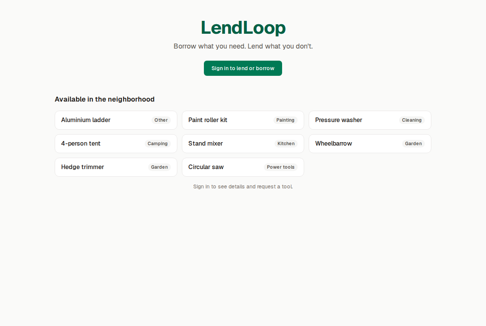
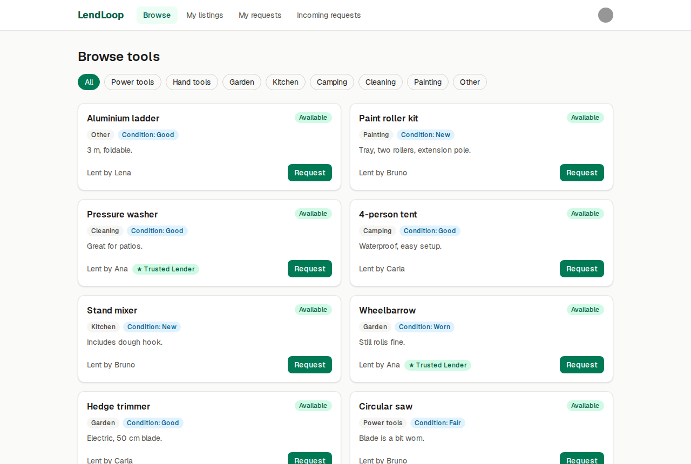
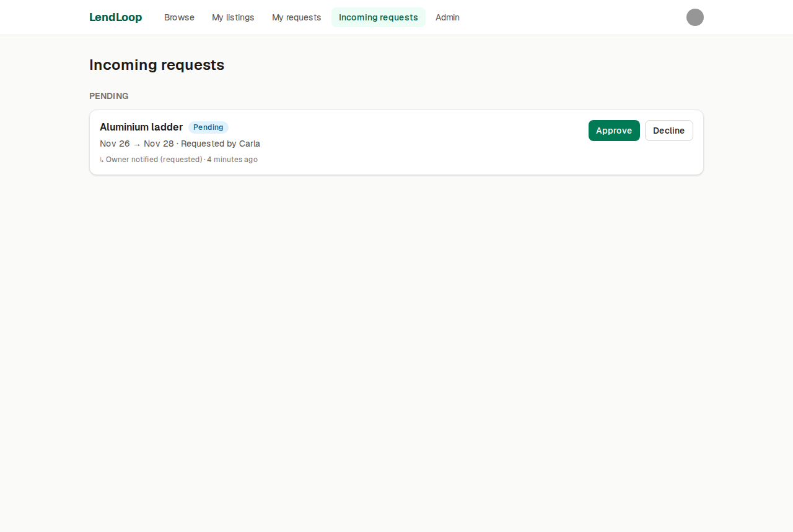
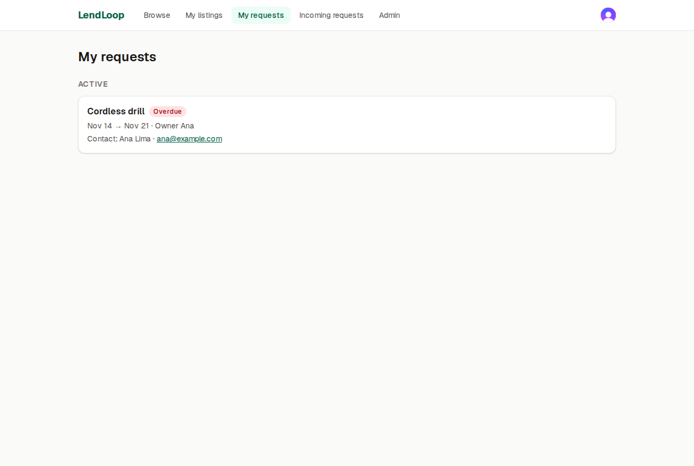
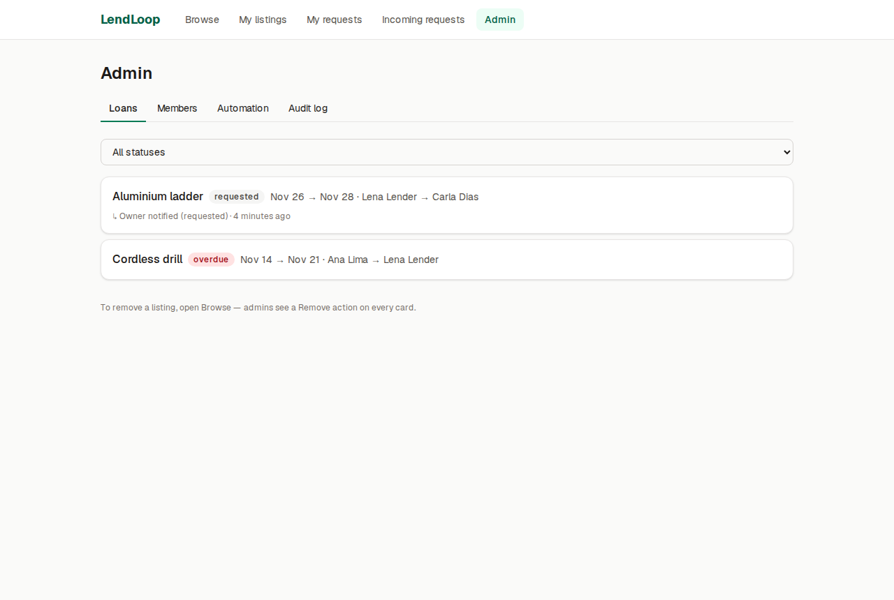
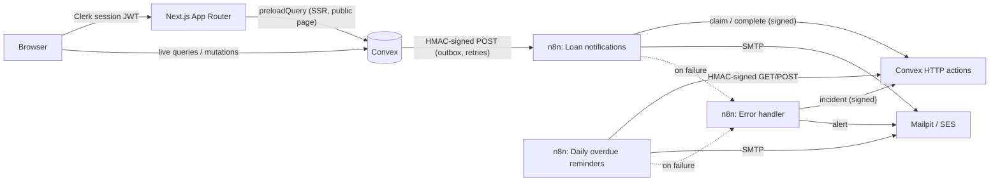

# LendLoop

[](https://github.com/RoniedsonSouza/lendloop/actions/workflows/ci.yml)

**Borrow what you need. Lend what you don't.**

A neighborhood tool-lending board: neighbors list tools, request to borrow them for a date range, and get automated notifications and overdue reminders handled by n8n.

**Stack:** Next.js 16 (App Router) · Clerk · Convex · n8n 2.48 · TypeScript

---

## Contents

1. [Screenshots](#screenshots)
2. [Reviewer quick start](#reviewer-quick-start)
3. [Manual setup (local development)](#manual-setup-local-development)
4. [Environment variables](#environment-variables)
5. [Architecture](#architecture)
6. [Roles and access control](#roles-and-access-control)
7. [Automation (n8n)](#automation-n8n)
8. [Security decisions](#security-decisions)
9. [Data minimization](#data-minimization)
10. [Testing](#testing)
11. [Product decisions](#product-decisions)
12. [Known limitations](#known-limitations)
13. [What I would change for production](#what-i-would-change-for-production)

---

## Screenshots

| Public page (no owner data) | Browse (signed in) |
|---|---|
|  |  |
| **Incoming requests (owner)** | **My requests (overdue loan, contact shared after approval)** |
|  |  |
| **Admin console** | |
|  | |

Captured with Playwright (`SCREENSHOTS=1 npx playwright test --project=screenshots`) on a fresh deployment, using only the Clerk test users and the seeded demo neighbors.

---

## Reviewer quick start

You need **Node 24**, **Docker**, and a free **Clerk** account (≈5 minutes, below). No Convex account, no tunnels, no cloud setup. No keys are shared in this repo: you use your own Clerk development instance.

```bash
npm ci
# create .env.local with your Clerk keys (next section)
npm run demo                                   # Convex (local) + secrets + n8n + Mailpit + the app
# sign in at http://localhost:3000, then in another terminal:
npm run demo:seed -- you@example.com           # makes you an admin and loads demo data
```

`npm run demo` is safe to re-run. It:
1. creates a local Convex deployment without an account (`CONVEX_AGENT_MODE=anonymous`) and pushes the functions;
2. runs `npm run setup`: generates the HMAC secrets and the n8n encryption key into the git-ignored `.env` and `.secrets/`, and sets the Convex environment;
3. starts n8n and Mailpit with `docker compose up -d --wait` (the `n8n-import` container creates the encrypted credentials and publishes the workflows);
4. starts Next.js and `convex dev` (`npm run dev`).

Then try the [demo walkthrough](#demo-walkthrough).

> **Why not a fully containerized stack?** I evaluated a `docker compose` setup with the self-hosted Convex backend image (`ghcr.io/get-convex/convex-backend`). The image could not be pulled anonymously from this environment (`denied`), so it could not be verified end-to-end. The local Convex deployment managed by the Convex CLI is the same backend binary, needs no account, and the flow above was tested from a clean clone (`npm ci && npm run demo`, then the full E2E suite).

### Clerk keys in about 5 minutes

1. Sign up at [dashboard.clerk.com](https://dashboard.clerk.com) and create an application (Email sign-in is enough). A development instance is created automatically.
2. **Integrations → Convex → enable.** This creates the `convex` JWT template that Convex validates.
3. **Sessions → Customize session token**, paste these claims (the default token has no email) and save:
   ```json
   { "name": "{{user.full_name}}", "given_name": "{{user.first_name}}", "email": "{{user.primary_email_address}}" }
   ```
4. **API keys**: copy the publishable key, the secret key and the **Frontend API URL** into `.env.local` (git-ignored):
   ```bash
   NEXT_PUBLIC_CLERK_PUBLISHABLE_KEY=pk_test_...
   CLERK_SECRET_KEY=sk_test_...
   CLERK_JWT_ISSUER_DOMAIN=https://<your-app>.clerk.accounts.dev
   NEXT_PUBLIC_APP_TIMEZONE=America/Sao_Paulo
   ```

### Test accounts

You don't need real inboxes. Clerk **development** instances treat any address containing `+clerk_test` as a test address: no email is sent, and the verification code is always **`424242`**. Sign in with, for example, `alice+clerk_test@example.com` and `bob+clerk_test@example.com` (one per browser profile) to play owner and borrower.

These addresses only work against **your own** Clerk development instance; they are not shared accounts, and no Clerk keys are committed. The E2E suite creates its users the same way (`lender+clerk_test@example.com`, `borrower+clerk_test@example.com`, `admin+clerk_test@example.com`) through the Clerk Backend API with your `CLERK_SECRET_KEY`.

---

## Manual setup (local development)

The steps `npm run demo` automates, if you prefer to run them yourself. Prerequisites and `.env.local` as in the [reviewer quick start](#reviewer-quick-start).

**1. Convex (local) and secrets.**

```bash
npx convex dev --once   # choose "Start without an account"; writes the Convex URLs to .env.local
npm run setup           # generates HMAC secrets and the n8n key into the git-ignored .env and .secrets/, then sets the Convex env
```

On a brand-new deployment the first `convex dev --once` creates the deployment but reports that `CLERK_JWT_ISSUER_DOMAIN` is not set. That is expected: `npm run setup` sets it, and the next `convex dev` pushes the functions.

**2. n8n and Mailpit.**

```bash
docker compose up -d
```

The `n8n-import` container creates the encrypted n8n credentials from `.env`, then imports and publishes the four workflows. Open http://localhost:5678 once to create the n8n owner account; it takes over the imported workflows.

**3. Run the app.**

```bash
npm run dev             # Next.js on :3000 + `convex dev`
```

### Demo walkthrough

1. Sign in at http://localhost:3000.
2. Make yourself an admin and load demo data (`npm run demo:seed -- you@example.com` does both):
   ```bash
   npx convex run admin:grantAdmin '{"email":"you@example.com"}'
   npx convex run seed:demo '{"email":"you@example.com"}'
   ```
   There is deliberately no UI path to become an admin. The seed creates neighbors and tools, a loan of yours that is 3 days overdue, and a new request for your ladder. The request notification shows up in **Mailpit** at http://localhost:8025.
3. Run the daily reminder now:
   ```bash
   npm run n8n:remind
   ```
   The reminder lands in Mailpit, and **My requests** shows "Reminder sent just now". Run it again: nothing is sent twice.
4. See failure handling:
   1. `docker compose stop mailpit`
   2. Approve a request in the app.
   3. The delivery fails, the error workflow runs, and the incident appears under **Admin → Automation**.
   4. `docker compose start mailpit`

| URL | What |
|---|---|
| http://localhost:3000 | App |
| http://localhost:5678 | n8n |
| http://localhost:8025 | Mailpit (local inbox; no real email leaves your machine) |
| `npx convex dashboard` | Convex data and logs |

> **Prefer Convex Cloud?** A cloud deployment can't reach n8n on your `localhost`. Expose n8n with a tunnel (for example `cloudflared tunnel --url http://localhost:5678`), then:
> - set `N8N_LOAN_EVENTS_URL` in Convex to `<tunnel>/webhook/lendloop/loan-events`;
> - set `LENDLOOP_CONVEX_URL_FROM_N8N` in `.env` to your `https://<deployment>.convex.site`.

---

## Environment variables

Secrets are marked 🔒. None are committed: `.env*` and `.secrets/` are git-ignored, and `.env.example` lists the names only.

| Variable | Where | Purpose |
|---|---|---|
| `NEXT_PUBLIC_CLERK_PUBLISHABLE_KEY` | `.env.local` | Clerk frontend key |
| `CLERK_SECRET_KEY` 🔒 | `.env.local` | Clerk server key (Next.js) |
| `CLERK_JWT_ISSUER_DOMAIN` | `.env.local` → Convex | Clerk Frontend API URL; Convex validates JWTs against it |
| `NEXT_PUBLIC_CONVEX_URL`, `NEXT_PUBLIC_CONVEX_SITE_URL` | `.env.local` | Written by `convex dev` |
| `NEXT_PUBLIC_APP_TIMEZONE` / `APP_TIMEZONE` | `.env.local` / Convex, `.env` | Timezone of the neighborhood. Every calendar date uses it, and so does the n8n schedule |
| `APP_URL` | Convex, `.env` | Links in emails |
| `N8N_LOAN_EVENTS_URL` | Convex | n8n webhook for loan events |
| `LENDLOOP_WEBHOOK_SECRET` 🔒 | Convex + n8n credential | HMAC key, Convex → n8n |
| `LENDLOOP_AUTOMATION_SECRET` 🔒 | Convex + n8n credential | HMAC key, n8n → Convex |
| `ALLOW_SEED` | Convex | Enables `seed:demo`; only `npm run setup` sets it, locally |
| `LENDLOOP_CONVEX_URL_FROM_N8N` | `.env` | Convex HTTP-actions URL as seen from the n8n container |
| `OPS_ALERT_EMAIL` | `.env` | Recipient of error-workflow alerts |
| `SMTP_*` 🔒 | `.env` | Optional real SMTP; defaults to Mailpit |
| `.secrets/n8n_encryption_key` 🔒 | file → Docker secret | n8n credential encryption key, mounted via `N8N_ENCRYPTION_KEY_FILE` |

Convex env vars are declared and typed in `convex/convex.config.ts`. Code reads the typed `env`, never `process.env`, and a lint rule enforces it.

---

## Architecture



```
app/                 Next.js routes: public page (/), (app)/tools|listings|requests|incoming|admin
components/, lib/    UI primitives, hooks, formatting
convex/
  schema.ts          users, tools, loans, deliveries, incidents, auditLog (all reads are indexed)
  lib/functions.ts   role-aware function builders (the only place raw query/mutation are used)
  lib/domain.ts      categories, limits, loan state machine (pure, unit-tested)
  tools.ts loans.ts admin.ts users.ts seed.ts
  automation/        outbox.ts (Convex→n8n), deliveries.ts (ledger), http.ts (signed endpoints)
n8n/
  src/build.mjs      generates workflows/*.json; Code-node sources live in src/code/*.js
  workflows/         the exported workflows (credential references only)
  credentials/       credential TEMPLATE (placeholders), rendered from env by n8n/init/init.sh
scripts/             setup.mjs, demo.mjs, demo-seed.mjs, check-workflows.mjs
e2e/                 Playwright specs, Clerk test-user setup, screenshot capture
```

**Why Convex local plus Docker:** an evaluator only needs a Clerk account, with no tunnels and no cloud setup.

**Pages:**
- The public page is server-rendered with `preloadQuery` and then becomes reactive.
- Signed-in pages use live Convex queries. When an owner approves a request, the borrower's screen updates without a refresh.

---

## Roles and access control

Clerk only **authenticates**. All **authorization** lives in Convex functions:

- **Role-aware builders** (`convex/lib/functions.ts`):
  - `publicQuery`: anonymous; returns minimal projections.
  - `memberQuery` / `memberMutation`: resolves the user from the JWT; otherwise `UNAUTHENTICATED`.
  - `adminQuery` / `adminMutation`: otherwise `FORBIDDEN`.
- **Resource checks** sit inside each handler, deny by default. For example, only the tool's owner may approve.
- **A lint guard** (`no-restricted-imports`) fails the build if a Convex file outside `convex/lib` uses the raw `query`/`mutation`. A new public function can't skip the check by accident.
- **Role and Trusted Lender live in the Convex `users` table**, not in JWT claims. Changes apply immediately, and there is a single source of truth. The first admin is granted via the CLI only, which is audited.
- **Admin actions are audited**: removing someone else's listing, Trusted on/off, and admin grants. The log is visible under Admin → Audit log.

| Operation | Anonymous | Member | Admin |
|---|---|---|---|
| Public list (name + category of available tools) | ✅ | ✅ | ✅ |
| Browse with availability, create listing | ❌ | ✅ | ✅ |
| Edit listing | ❌ | own only | own only |
| Remove listing | ❌ | own only | any (audited) |
| Request to borrow | ❌ | not own tool | not own tool |
| Approve / decline / mark returned | ❌ | tool owner | tool owner |
| Cancel request | ❌ | borrower | borrower |
| View all loans, Trusted Lender, automation & audit | ❌ | ❌ | ✅ |

Every cell is covered by tests in `convex/*.test.ts`.

---

## Automation (n8n)

Four workflows are generated by `n8n/src/build.mjs` (`npm run n8n:build`) and checked in under `n8n/workflows/`:

| Workflow | What it does |
|---|---|
| **Loan notifications** | Webhook ← Convex: verify HMAC → claim → respond 202 → plain-text email to the relevant user → record `sent`/`failed` |
| **Daily overdue reminders** | 09:00 daily (or `npm run n8n:remind`): fetch overdue loans → per loan: claim → email the borrower → record the result |
| **Error handler** | Error Trigger for both workflows: alert ops by email and record an incident in Convex (no payload data) |
| **Signed Convex request** | Sub-workflow that signs and sends every n8n → Convex call, so signing lives in one place |

### HMAC (both directions)

```
X-LendLoop-Timestamp: <unix seconds>
X-LendLoop-Signature: v1=<hex HMAC-SHA256(secret, "<timestamp>.<raw body>")>
```

- **Exact bytes:** the signature covers the raw body. n8n reads the webhook's raw body, and the sub-workflow serializes once and sends that same string.
- **Replay window:** ±300 s. Replays inside the window cannot cause duplicate messages or records: every write goes through the delivery ledger, which deduplicates by key.
- **Constant-time comparison:** Convex uses `crypto.subtle.verify`; the n8n Code node uses an XOR loop.
- **One secret per direction.**
- **Where the n8n secrets live:** in **encrypted n8n credentials** (type `crypto`, used by the Crypto node), not in env vars or Code nodes. The running n8n container has no secret in its environment.
- **Generic 401** on failure; the reason is never revealed.

### Reliability: outbox + delivery ledger

Every automated message is one row in `deliveries`, with a deterministic key: `loan:<loanId>:<status>` or `reminder:<loanId>:<date>`.

```
loan update:  queued ─(webhook 2xx)▶ dispatched ─claim▶ claimed ─▶ sent | failed
                 └─(6 attempts or 4xx)▶ dead
reminder:                      (claim creates) claimed ─▶ sent | failed
no progress for 30 min ▶ stale (visible; never re-sent automatically)
claim(key): new / queued / dispatched / failed / dead → "send"     claimed / sent / stale → "skip"
```

- **Transactional outbox.** The mutation that changes a loan inserts the delivery and schedules its dispatch in the same transaction. A notification exists if and only if the change committed.
- **Retries with backoff.** On 5xx, 408, 429 or a network error, the delivery is retried after 30 s, 2 m, 8 m, 30 m and 2 h (±20% jitter). Other 4xx responses, such as a bad signature, are configuration errors, so they go straight to `dead`. An attempt token ensures only one dispatch chain runs per delivery.
- **No duplicates.**
  - n8n **claims** before sending. Convex mutations are serializable, so two concurrent claims of the same key can't both win.
  - Redeliveries, workflow re-runs and n8n retries get `skip`.
  - Write-backs (`complete`, incidents) are idempotent.
  - The overdue endpoint excludes loans already reminded today.
- **At most once, by design.** A duplicate reminder is worse than a missed one, and tomorrow's run reminds again.
- **No silent failures.**
  - n8n nodes retry 3× and then route to the error workflow (ops email + incident).
  - Convex marks deliveries `dead` / `failed` / `stale`.
  - A cron re-queues dispatches lost by a crashed action.
  - Everything shows up under **Admin → Automation**.
- **Bonus.** Each loan card shows its recent automation activity ("Reminder sent 2 days ago"), read from the same ledger.

`npm run check:workflows` (in CI) fails on any of these: `pinData`, credential objects with anything but `id`/`name`, secret-looking strings, a missing error workflow, an HTTP/email node without retries, or JSON that drifted from the generator.

> Workflows are generated from code instead of hand-exported. This makes the Code-node JavaScript testable: `n8n/contract.test.ts` runs it against the Convex HMAC implementation. It also keeps the JSON diffable. To change a workflow, edit `n8n/src` and run `npm run n8n:build`.

---

## Security decisions

- **Authorization on the server only.** See above. The UI hides what you can't do, but every rule is enforced and tested in Convex. Protecting the Next.js route group with `auth.protect()` is only a UX nicety.
- **Integration security:** HMAC in both directions, per-direction secrets, raw-body signing, replay window, constant-time verification. Requests are processed in this order:
  1. verify the signature;
  2. reject oversized bodies (16 KB → 413);
  3. parse;
  4. validate (Convex validators, `normalizeId` for external IDs);
  5. execute.
- **Secrets:**
  - Stored only in Convex env, n8n encrypted credentials, and the n8n key file (as a Docker secret).
  - Generated with 32 random bytes by `npm run setup`.
  - Kept out of the repo, the workflow JSON and the n8n process env.
  - CI runs gitleaks and the workflow guard.
- **Input validation:**
  - Every Convex function has argument **and** return validators, plus explicit length, date and range limits.
  - Emails are **plain text**, so a tool name can't inject HTML.
  - React escapes output.
- **Abuse limits:** at most 5 pending requests per user, one open request per tool per borrower, loans of 30 days at most, starting within 90 days.
- **Concurrency:** approvals re-check overlaps inside a serializable transaction, so two overlapping approvals can't both succeed.
- **Headers:** `nosniff`, `Referrer-Policy`, `frame-ancestors 'none'`, `Permissions-Policy`.
- **Local exposure:** n8n and Mailpit ports are bound to `127.0.0.1`. The local Convex backend listens on all interfaces (CLI default), so use it on a trusted network.

---

## Data minimization

- **Public page:** only *available* tools, and only `{ name, category }`, capped at 50. A test pins the exact keys returned.
- **Signed-in browsing:** shows the owner's **first name** only.
- **Contact details:** full name and email are shown **only to the two parties of an approved loan**, when they need to arrange pick-up.
- **"Overdue" status:** visible only to the owner, the borrower and admins. Everyone else sees "On loan".
- **Profile:** we store name and email from Clerk, nothing else. No phone, address or avatar. The description field asks people not to include contact details.
- **n8n payloads** carry only what the message needs: event type, delivery key, tool name, dates, the recipient's first name and email, the other party's first name, and a link. They carry no user IDs and no descriptions. The incident record contains workflow, node and error text only.
- **Retention:**
  - n8n doesn't store successful executions (`EXECUTIONS_DATA_SAVE_ON_SUCCESS=none`). Failed executions are kept for 7 days so they can be inspected and retried; they can contain the recipient's first name and email (a deliberate debugging trade-off — set `EXECUTIONS_DATA_SAVE_ON_ERROR=none` to rely only on the incidents table).
  - Convex purges delivery records and incidents after 90 days.
  - Logs reference IDs, never email addresses.

---

## Testing

| Suite | Command | Result (local run, 2026-11-24) |
|---|---|---|
| Unit / integration (Vitest + convex-test) | `npm test` | **88 passed** |
| End-to-end (Playwright + Clerk testing tokens) | `npm run test:e2e` | **21 passed** (6 setup + 15 specs) |
| Typecheck (generates Next route types first) | `npm run typecheck` | clean |
| Lint (incl. the authorization import guard) | `npm run lint` | clean |
| n8n workflow guard | `npm run check:workflows` | 4 workflows OK |

CI (`.github/workflows/ci.yml`) runs typecheck, lint, unit tests, the workflow guard and gitleaks on every push. E2E needs a Clerk instance, so it lives in a separate workflow (`e2e.yml`) that runs only when the repository has `CLERK_*` secrets and is skipped otherwise.

### Unit and integration tests

- The authorization matrix.
- The loan state machine, date and conflict rules, including overlapping approvals.
- The exact-keys projection test for the public page, with "today" computed on the server.
- The outbox with a mocked `fetch`: success, 5xx backoff, dead after 6 attempts, 4xx → dead, network errors, lost dispatch recovery.
- Ledger idempotency, and `complete` refusing deliveries that were never claimed.
- Retention purge in bounded batches.
- Signed HTTP endpoints: unsigned, tampered, expired, oversized, malformed, unknown ID.
- Contract tests that run the actual n8n Code-node JavaScript against the Convex signer and verifier.

### End-to-end tests

Run against the live local stack (`npm run demo` first). `e2e/global.setup.ts` loads your Clerk keys from `.env.local` (never printed), creates or reuses three `+clerk_test` users through the Clerk Backend API, signs each in with `@clerk/testing` and saves a storage state per user, then grants admin to one of them with `npx convex run admin:grantAdmin`. Tool names carry a per-run suffix, so the suite can be re-run against the same deployment.

Covered:

- **Public page:** tagline, "Sign in to lend or borrow", tools with name and category only (no owner name, email or description).
- **Route protection:** `/tools`, `/listings`, `/requests`, `/incoming`, `/admin` redirect anonymous visitors to sign-in.
- **Lending flow:** the lender creates listings → the borrower sees them in Browse with availability and filters by category → requests a date range → the lender sees it in **Incoming** and approves → contact details appear for both parties → **Mailpit receives the n8n approval email** for the borrower (polled via the Mailpit API) → the lender marks it returned and the tool is available again. **My listings** and **My requests** are checked along the way.
- **Admin:** a member sees no Admin link and gets "Admins only" on `/admin`; an admin marks a Trusted Lender (the badge appears in Browse) and removes another member's listing.

Optional variables: `E2E_BASE_URL` (default `http://localhost:3000`), `MAILPIT_API_URL` (default `http://localhost:8025/api/v1`).

---

## Product decisions

The brief leaves several points open. These were my calls:

- **Condition vs. availability.** Condition means wear: new, good, fair or worn. Availability is derived from loans: *Available*, *On loan · back Dec 5*, or *Overdue*.
- **Loan lifecycle:** `requested → approved → returned`, or `declined` / `cancelled`. *Overdue* is derived (approved, past the end date). Dates are calendar days in `APP_TIMEZONE`.
- **Who marks a return:** the **owner**, from the start date onward. The person who gets the tool back confirms it. This also closes a loan that was never picked up.
- **Borrower actions:** cancel while pending, or while approved but not yet started.
- **Conflicting requests:** approving a request auto-declines overlapping pending requests, and each borrower is notified.
- **Removing a listing:** a soft delete that is the same for owners and admins. It cancels pending requests and future bookings, with notifications. A loan already in progress continues until it is returned.
- **Admins** moderate by removing listings. They don't edit other people's listings and have no special power over others' requests.
- **Trusted Lender** is a badge shown to signed-in users. It never appears on the public page, because it is owner data.

---

## Known limitations

- **Failed n8n executions** keep the recipient's first name and email for 7 days. It is a debugging trade-off; set `EXECUTIONS_DATA_SAVE_ON_ERROR=none` to rely only on the incidents table.
- **Public list caching:** "today" is now computed on the server, so a caller can't make a lent tool appear available. Convex caches query results until the underlying data changes, so right after midnight the public list can show the previous day's availability until the next write to tools or loans.
- **Retention purge** filters deliveries by age without an index on creation time per status. It runs in bounded batches and reschedules itself, which is fine at this scale; at high volume, add a `(status, completedAt)` index.
- **Single neighborhood:** one timezone (`APP_TIMEZONE`) and one community per deployment.
- **No fully containerized demo** (see [Reviewer quick start](#reviewer-quick-start)); Convex runs as a CLI-managed local deployment.
- **E2E in CI** runs only when Clerk secrets are configured in the repository.

Fixed after the first review: `POST /automation/deliveries/complete` now requires a claimed delivery; the public list computes "today" on the server; `purgeOld` paginates.

---

## What I would change for production

- **Hosting:**
  - Convex production deployment.
  - Next.js on Vercel or AWS (Amplify/ECS).
  - n8n on **ECS Fargate** in queue mode (main + workers), with **RDS Postgres** and **ElastiCache Redis**, behind an ALB with TLS.
  - Expose only `/webhook/*` publicly; put the editor behind SSO/VPN.
  - Run task runners in external mode (`n8nio/runners` sidecar) to isolate Code-node execution.
- **Secrets:** **AWS Secrets Manager** (injected into tasks, or n8n External Secrets on Enterprise). Rotate keys with two valid HMAC secrets during the switch-over window. Use a Clerk production instance with MFA for admins.
- **Email and alerts:** **Amazon SES** with SPF, DKIM and DMARC, plus bounce and complaint handling. Send ops alerts to Slack or PagerDuty instead of email.
- **Observability:**
  - Sentry for Next.js and Convex.
  - Convex log streams and n8n metrics to Datadog.
  - Alerts on `dead`/`stale` deliveries and on error-workflow runs.
- **Abuse and compliance:**
  - `@convex-dev/rate-limiter` on mutations and endpoints, plus a WAF in front of the webhooks.
  - Ship the audit log to immutable storage.
  - Handle account deletion via a Clerk `user.deleted` webhook (svix-verified) that anonymizes the user.
  - Written retention policy and backups, and DPAs with every processor.
- **Engineering:**
  - Staging environment and infrastructure as code (Terraform).
  - Run the Playwright suite against staging on every deploy.
  - A strict CSP.
  - The `@convex-dev/workpool` component for dispatch parallelism at higher volume.
